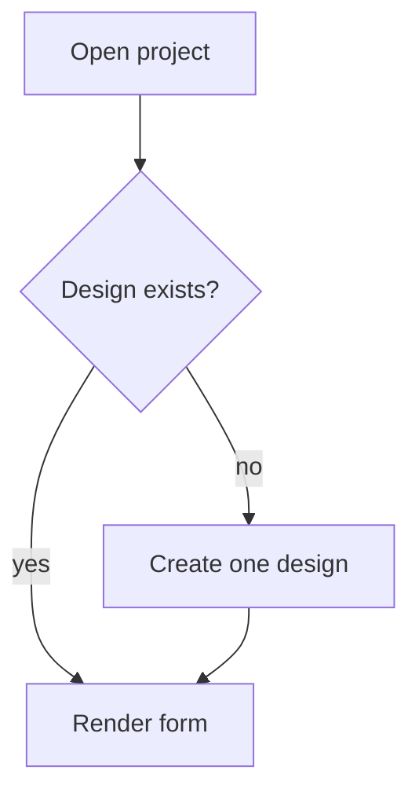

# Make PR

Goal: a reviewer reads the first 5 lines and knows what changed and why.

## Steps

1. Read the diff, `.github/pull_request_template.md` (it changes), and the PR if one exists:
   ```bash
   git diff main...HEAD --stat | tail -30
   gh pr view --json number,title,body,url
   ```

2. Write the body to a temp file: the template **verbatim**, with `## Description` filled
   using the layout below. For an existing PR, keep every other section and the
   `Resolves <TICKET-ID>` line exactly as they are in its body. Save screenshots outside the
   repo so `git add` skips them, and link each by its path,
   ``, numbered in the order a user sees them,
   in the template's screenshots section or under the Description if it has none.
   When the diff changes the shape of the code (components, call flow, files, tables,
   types), read [references/change-outline.md](references/change-outline.md) and add a
   change outline. Skip it for small fixes.
   Run the title and Description through the `unslop` skill before publishing.

3. Commit, push, and create or update the PR with one `--attach` per screenshot. `gh`
   (2.99 or newer) uploads each file and swaps its path in the body for the uploaded URL.
   Uploads can't be deleted, so attach only the final screenshots.
   ```bash
   git add -A && git commit -m "<type>(<scope>): <imperative summary>"
   git push -u origin HEAD
   gh pr create --title "<type>(<scope>): <imperative summary>" --body-file <tmpfile> \
     --label preview:web --attach /tmp/pr-screenshots/1-<slug>.png
   # existing PR:
   gh pr edit <number> --body-file <tmpfile> --attach /tmp/pr-screenshots/1-<slug>.png
   ```

4. Assess the PR with the [merge-risk](../merge-risk/SKILL.md) skill and post the result as
   a PR comment. On reruns, edit the existing comment that starts with `**Merge risk:`
   instead of adding another (`--edit-last` could overwrite an unrelated comment):
   ```bash
   id=$(gh api repos/{owner}/{repo}/issues/<number>/comments \
     --jq '[.[] | select(.body | startswith("**Merge risk:"))] | last | .id // empty')
   if [ -n "$id" ]; then
     gh api -X PATCH repos/{owner}/{repo}/issues/comments/$id -F body=@<riskfile>
   else
     gh pr comment <number> --body-file <riskfile>
   fi
   ```

5. Report the PR URL, the one-line summary you wrote, and the merge risk level with any ⚠️
   categories. Nothing else — when another skill called you, it writes the final message.

## Description layout

```markdown
**In one line:** <what a user notices now, plain language>

**The problem:** <1-2 short sentences>

**The fix:** <1-2 short sentences>

| Before | After |
| --- | --- |
| <old behaviour> | <new behaviour> |

**Evidence:**
- Before: `<command>` → <failing output>
- After: `<command>` → <passing output>

<mermaid diagram — only when flow or state order is the point>

<details><summary>Change outline</summary>

<one or two views from references/change-outline.md, in fenced blocks>

</details>
```

Drop any block that adds nothing. Two good lines beat five filler ones. The change outline
is for reviewers, so it stays collapsed below the parts anyone can read. Leave a blank line
after `<summary>` and before `</details>`, or GitHub won't render the fences inside.

## Rules

- **Simple technical English.** Short sentences. Names of things stay (`useQuery`,
  `cooling_designs`); explain the rest. No "leverage", "robust", "seamlessly".
- **Visual first.** A table or a mermaid diagram instead of a paragraph, whenever it fits.
  Mermaid renders natively on GitHub — use ```` ```mermaid ```` fences, `flowchart TD` or
  `sequenceDiagram`, max ~8 nodes, plain labels with no special characters.
- Code shape goes in the change outline. Outside it, include a file reference or short
  snippet only when it makes the change easier to understand.
- **Under ~200 words** in the Description section, not counting the change outline.
- **No new claims.** Describe only what the diff does. No invented testing, metrics, or tickets.
- **Evidence.** Screenshots are the best proof for visual changes. For anything else, show the
  test or command that failed before and passes after, trimmed to the lines that matter.
  Include only output you actually ran in this session; with none, drop the block.
- **Do not touch** the title, labels, checklist ticks, or the Linear `Resolves` line —
  unless the user asks.
- Screenshots stay if they are already there.

## Example Description

````markdown
**In one line:** Opening a cooling load project no longer hangs on the loading spinner.

**The problem:** The page created a cooling design, then re-ran the same effect, which
created another one. The list never settled, so the spinner never stopped.

**The fix:** Create the design once per project and wait for the write to land before
rendering.

| Before | After |
| --- | --- |
| Endless spinner, duplicate designs in the DB | Page opens, one design per project |



<details><summary>Change outline</summary>

```diff
 <CoolingLoadPage> (apps/web/src/routes/cooling-load.tsx)
-  useEffect → createDesign()        # re-ran on every render
+  useEnsureDesign(projectId)        # creates once, awaits the write
+  isPending ? <Spinner> : <CoolingForm>
```

</details>

````
